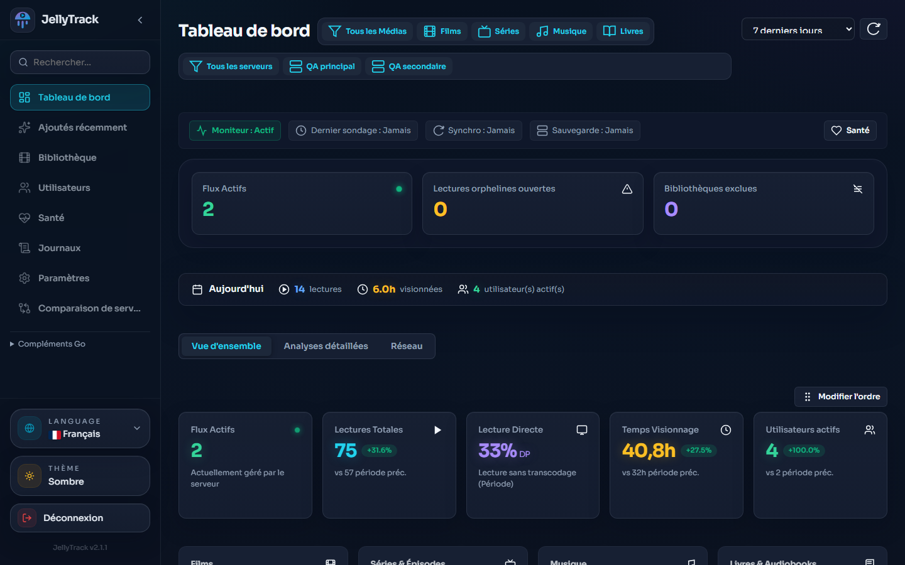
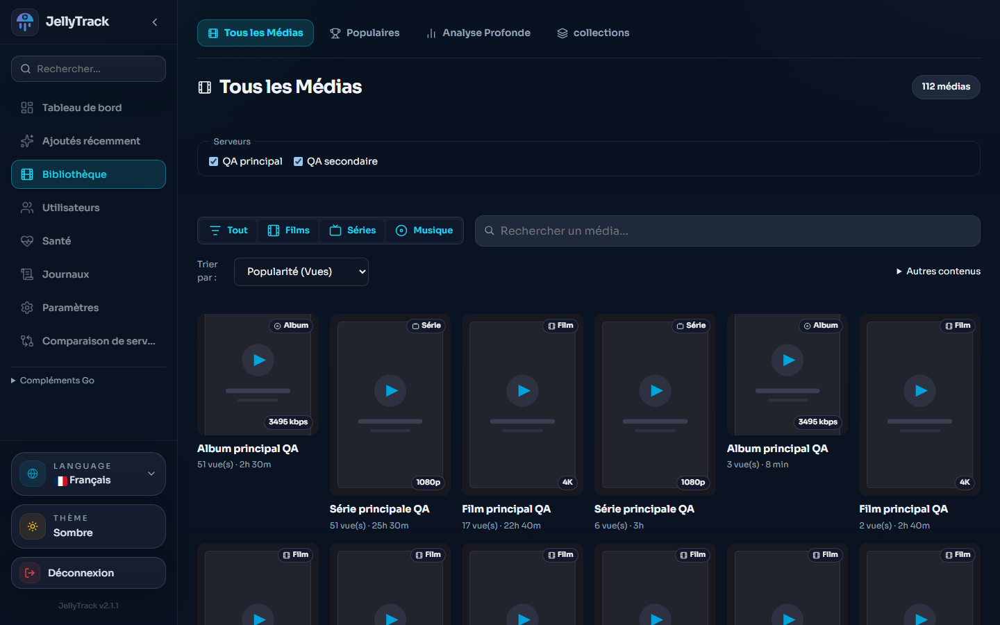
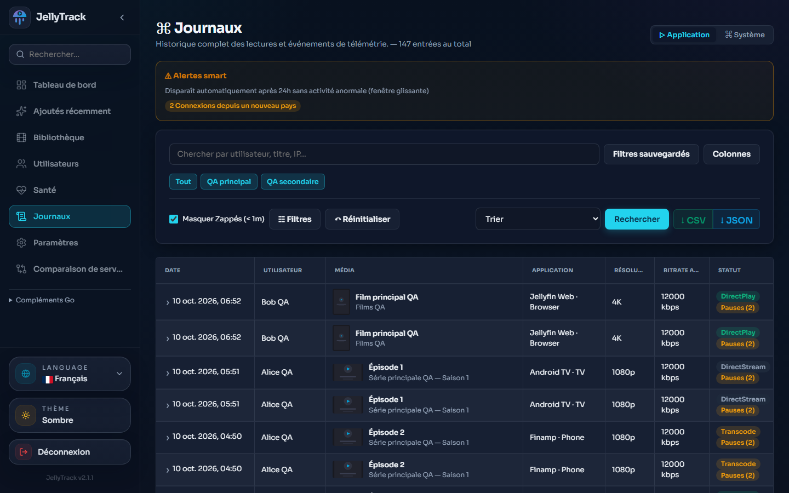
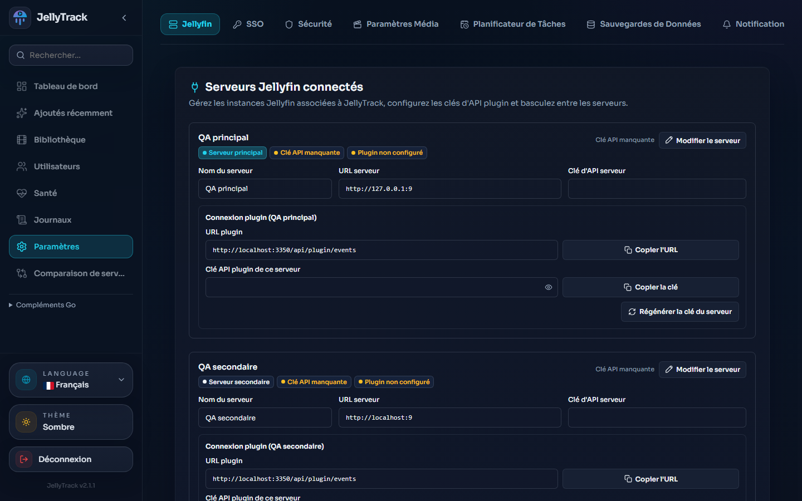
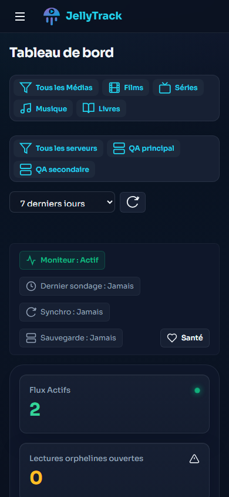
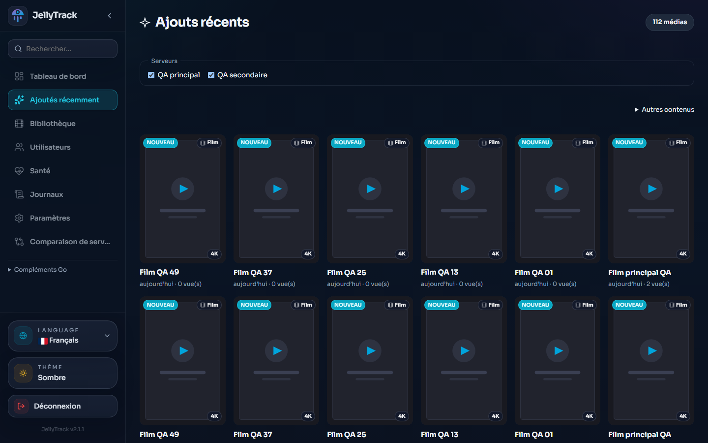
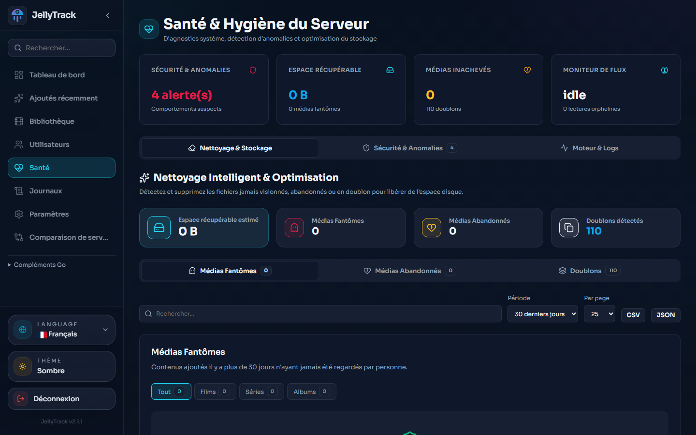

<p align="center">
  
</p>

<h1 align="center">JellyTrack</h1>

<p align="center">
  <strong>Playback analytics, live monitoring and detailed Jellyfin telemetry — powered by Go.</strong>
</p>

<p align="center">
  <a href="https://github.com/maelmoreau21/JellyTrack/actions/workflows/ci.yml"></a>
  <a href="https://github.com/maelmoreau21/JellyTrack/actions/workflows/docker-publish.yml"></a>
  <a href="LICENSE"></a>
  <a href="https://github.com/maelmoreau21/JellyTrack/tree/codex/frontend-recovery"></a>
</p>

> **Development status:** This README documents the Go implementation on [`codex/frontend-recovery`](https://github.com/maelmoreau21/JellyTrack/tree/codex/frontend-recovery), not the older application on `main`. The repository's `VERSION` file currently reads `3.0.0`; that does not by itself establish a published, production-ready v3 release. Historical UI parity and integration testing remain in progress.

## Screenshots

Screenshots of the **Go interface**, captured during the isolated parity audit using synthetic test data (not a production Jellyfin installation). Click an image to inspect it in full resolution.

### Dashboard

[](docs/final-audit/captures/go-final-dashboard-desktop-dark.png)

### Users & profiles

[](docs/final-audit/captures/go-final-users-desktop-dark.png)

### Media catalogue

[](docs/final-audit/captures/go-final-media-all-desktop-dark.png)

### Playback history

[](docs/final-audit/captures/go-final-logs-desktop-dark.png)

### Jellyfin connection settings

[](docs/final-audit/captures/go-final-settings-jellyfin-desktop-dark.png)

<details>
<summary>More screenshots (mobile, recent additions and system health)</summary>

**Mobile dashboard**



**Recently added**



**System health**



</details>

## Highlights

- **Live playback:** current Jellyfin sessions and playback details, including direct play and transcoding, with supported administrative actions.
- **Playback history:** filtering, session details and exports, with consolidation of playback events.
- **Analytics:** activity over time, popular media, viewing patterns, media categories, client/platform usage and network/transcoding insights.
- **Media and users:** searchable catalogue, recent additions, media details, user profiles and activity statistics.
- **Advanced telemetry:** plugin-assisted pause/resume, seeks, client details, language changes and other events where available.
- **Multiple Jellyfin servers:** configuration and filtering where supported by the current deployment mode.
- **Authentication:** local administrator access and OpenID Connect (OIDC) integrations such as Authentik.
- **Administration:** health views, scheduled tasks, data cleanup, backup and configuration interfaces.
- **Localization:** bundled translations, dark/light themes and mobile-friendly layout.

Some features depend on the installed Jellyfin plugin, the connected Jellyfin version and available event data. Consult [the parity audit](docs/FINAL_PARITY_AUDIT.md) for verification scope and remaining differences.

## Architecture

JellyTrack serves its web UI from a **Go application**. HTML, CSS, JavaScript, Chart.js and translations are embedded with `embed.FS`. No Node.js, Next.js or React runtime is required to run the Go build.

| Layer | Implementation |
| --- | --- |
| API, authentication and background tasks | Go (`internal/`) |
| Frontend | HTML, CSS and vanilla JavaScript (`web/dist/`) |
| Graphs | Bundled Chart.js 4.5.1 |
| Local database | SQLite via `modernc.org/sqlite` (CGO-free) |
| External database | PostgreSQL via `pgx` |
| Database changes | SQL migrations in `migrations/sqlite/` and `migrations/postgres/` |
| Deployment | Go binary or multi-stage Docker image |

The database is **selectable**: SQLite needs no separate database server, while PostgreSQL is suitable for external database deployments. These modes require different deployment configuration; the supplied Compose file currently targets PostgreSQL.

## Quick start — Docker Compose (PostgreSQL)

The checked-in [`docker-compose.yml`](docker-compose.yml) currently starts PostgreSQL and requires its credentials. It is **not** a SQLite-only Compose configuration.

```bash
git clone https://github.com/maelmoreau21/JellyTrack.git
cd JellyTrack
git switch codex/frontend-recovery
cp .env.example .env
```

Edit `.env`, replacing all `CHANGE_ME_*` placeholders with real values. At a minimum, review the Jellyfin URL/API key, database password, application secret, webhook secret and plugin key pepper. Set `JELLYTRACK_URL` to the browser-facing URL of the application and change the default URLs for your environment.

Build **from this branch**, rather than assuming the GHCR `latest` tag is the Go implementation:

```bash
docker compose up -d --build
```

Open **http://localhost:3000** (or the port configured with `APP_PORT`). Inspect startup logs if initial setup is not displayed:

```bash
docker compose logs -f JellyTrack
```

**Existing installations:** back up application data and PostgreSQL volumes before upgrading. Do not replace the PostgreSQL 17 image with PostgreSQL 18 on an existing data directory without performing a supported major-version upgrade and checking PostgreSQL 18's changed volume/`PGDATA` layout.

## SQLite mode (no PostgreSQL server)

The Go application supports an embedded SQLite database. The existing Compose file still has a required PostgreSQL service, so use a separate SQLite Compose override or launch the locally built image directly. For example, after configuring `.env`:

```bash
docker build -t jellytrack:local .
docker volume create jellytrack_data
docker run -d --name jellytrack \
  --env-file .env \
  -e DATABASE_DRIVER=sqlite \
  -e DATABASE_PATH=/data/jellytrack.db \
  -p 3000:3000 \
  -v jellytrack_data:/data \
  --restart unless-stopped \
  jellytrack:local
```

This command is a **single-instance example**, not a migration of an existing PostgreSQL database. Running multiple application replicas against the same SQLite file is not recommended. The image contains the app and web assets; a separate Jellyfin server is still required.

## Connect Jellyfin and its plugin

JellyTrack uses a Jellyfin API key for server integration. Detailed playback/download telemetry is provided by the companion [Jellyfin.Plugin.JellyTrack](https://github.com/maelmoreau21/Jellyfin.Plugin.JellyTrack) where supported.

To add the plugin repository in Jellyfin, use **Dashboard → Plugins → Repositories** and enter:

```text
https://raw.githubusercontent.com/maelmoreau21/Jellyfin.Plugin.JellyTrack/main/manifest.json
```

Install a plugin version compatible with your Jellyfin server, restart Jellyfin, and configure its JellyTrack URL and shared authentication key as instructed in the application. The event ingestion endpoint is `POST /api/plugin/events`; do not expose event credentials in screenshots or logs.

## Authentication and configuration

Configuration starts from [`.env.example`](.env.example). Important variables include:

| Variable | Purpose |
| --- | --- |
| `JELLYTRACK_URL` | Public URL used to access JellyTrack |
| `JELLYTRACK_SECRET` | Application/session secret — use a long random value |
| `JELLYFIN_URL`, `JELLYFIN_API_KEY` | Jellyfin server address and API key |
| `DATABASE_DRIVER` | `sqlite` or `postgres` |
| `DATABASE_PATH` | SQLite database file path |
| `DATABASE_URL` | Optional full PostgreSQL connection URL |
| `POSTGRES_*` | PostgreSQL credentials when using the supplied Compose configuration |
| `JELLYFIN_WEBHOOK_SECRET`, `PLUGIN_KEY_PEPPER` | Plugin/webhook authentication secrets |
| `OIDC_ENABLED`, `OIDC_URL`, `OIDC_CLIENT_ID`, `OIDC_CLIENT_SECRET` | Optional OIDC single sign-on |
| `OIDC_USER_GROUP`, `OIDC_ADMIN_GROUP` | OIDC group mapping |
| `JELLYTRACK_LOCAL_ADMIN_USER`, `JELLYTRACK_LOCAL_ADMIN_PASSWORD` | Optional local administrator access |
| `TZ`, `APP_PORT`, `PORT` | Timezone and port configuration |

For an OIDC provider, register the callback URL `https://your-jellytrack-domain/api/auth/oidc/callback` and configure the provider's issuer URL, client and groups as appropriate. Use HTTPS for remote access. Never commit `.env`, database files, session cookies or API keys.

## Develop and test

The branch currently declares **Go 1.27.2** in `go.mod`. Use a compatible stable Go toolchain.

```bash
go mod download
go test ./...
go vet ./...
go build ./...
```

To run without Docker using a local SQLite database:

```bash
DATABASE_DRIVER=sqlite DATABASE_PATH=./data/jellytrack.db go run .
```

The last command uses POSIX shell syntax; on PowerShell, set environment variables using `$env:DATABASE_DRIVER` and `$env:DATABASE_PATH` first.

For frontend implementation notes, see [Frontend Architecture](docs/FRONTEND_ARCHITECTURE.md). For the historical comparison, see [Final Parity Audit](docs/FINAL_PARITY_AUDIT.md). The screenshots in this README come from the Go parity validation set and are not evidence of production integration tests.

## License

MIT — see [LICENSE](LICENSE).
